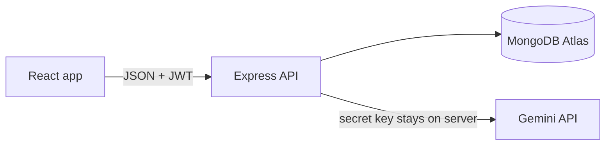

# Studyloop – AI Study & Habit Planner

A full-stack planner that turns your goals and weekly hours into a 7-day study plan using Google Gemini. Track tasks, build habit streaks, and stay focused with a built-in timer.

## Features

**Planning**
- AI weekly plan: type your goals and hours, get sessions with subject tags on your calendar
- Simple backup plan if the AI is busy, so the app never just fails
- "Clear plan" button to remove unfinished planned tasks and start again
- Month calendar showing how much of each day is done

**Tasks**
- Quick duration buttons (15, 30, 45, 60 minutes)
- Coloured subject tags with a filter
- Day summary, for example "3 of 5 done, 1h 20m left"
- Missed tasks list with a one-click "Move to today"

**Habits**
- Current streak, best streak and 30-day completion rate
- 7-day row where you can tap any day to fix a missed tick
- "2 of 4 done today" progress

**Focus**
- Today panel with combined progress for tasks and habits
- Focus timer (up to 25 minutes) that marks the task done when it ends

**Accounts**
- Register and log in, each user sees only their own data

## Tech stack

| Part | Technology |
|---|---|
| Frontend | React (Vite), plain CSS |
| Backend | Node.js, Express |
| Database | MongoDB Atlas (Mongoose) |
| Auth | JWT, bcrypt |
| AI | Google Gemini API |
| Hosting | Vercel (two projects) |

## Project structure

```
study-planner/
├── backend/
│   ├── index.js        Express app and all routes
│   ├── models.js       Mongoose models (User, Task, Habit, PlanUse)
│   ├── ai.js           Gemini calls, retries, backup plan
│   └── vercel.json
└── frontend/
    └── src/
        ├── App.jsx, api.js, App.css
        └── components/ Login, Today, Planner, Calendar, Tasks, Habits
```

## Architecture



## API routes

| Method | Route | What it does |
|---|---|---|
| POST | `/register`, `/login` | Create account, log in |
| GET, POST | `/tasks` | List and create tasks |
| PATCH, DELETE | `/tasks/:id` | Mark done, move to another date, delete |
| GET, POST | `/habits` | List and create habits |
| POST | `/habits/:id/toggle` | Mark or unmark a habit for a date |
| DELETE | `/habits/:id` | Delete a habit |
| POST | `/plan` | Generate a weekly plan with AI |
| DELETE | `/plan?from=YYYY-MM-DD` | Remove unfinished planned tasks from a date |

All routes except register and login need a login token.

## Security and reliability
- Passwords are hashed with bcrypt, logins use 7-day JWTs
- Every task and habit query also checks the user id, so users cannot touch each other's data
- Input is checked on the server for every route
- Rate limits: 20 login attempts per 15 minutes, 5 AI requests per hour per IP, and 10 AI plans per day per user
- The Gemini API key is only in server environment variables, never in the browser
- AI calls use try/catch, retry when Gemini is busy, try backup models, and fall back to a simple plan

## Run locally

You need Node.js 20 or newer, a free MongoDB Atlas database, and a free Gemini key from https://aistudio.google.com.

**1. Backend**
```
cd backend
npm install
```
Copy `.env.example` to `.env` and fill in:
```
MONGODB_URI=your MongoDB Atlas connection string
JWT_SECRET=any long random text
GEMINI_API_KEY=your Gemini key
AI_MODEL=gemini-3.8-flash
```
Then start it:
```
npm run dev
```
It runs at http://localhost:5010. Opening that address should show "Study planner API is running".

**2. Frontend** (second terminal)
```
cd frontend
npm install
```
Copy `.env.example` to `.env`:
```
VITE_API_URL=http://localhost:5010
```
Then start it:
```
npm run dev
```
Open http://localhost:5173.


## Ideas to extend
Email reminders with a scheduled job, weekly analytics charts, drag-and-drop calendar, automated tests with Vitest and Supertest.
